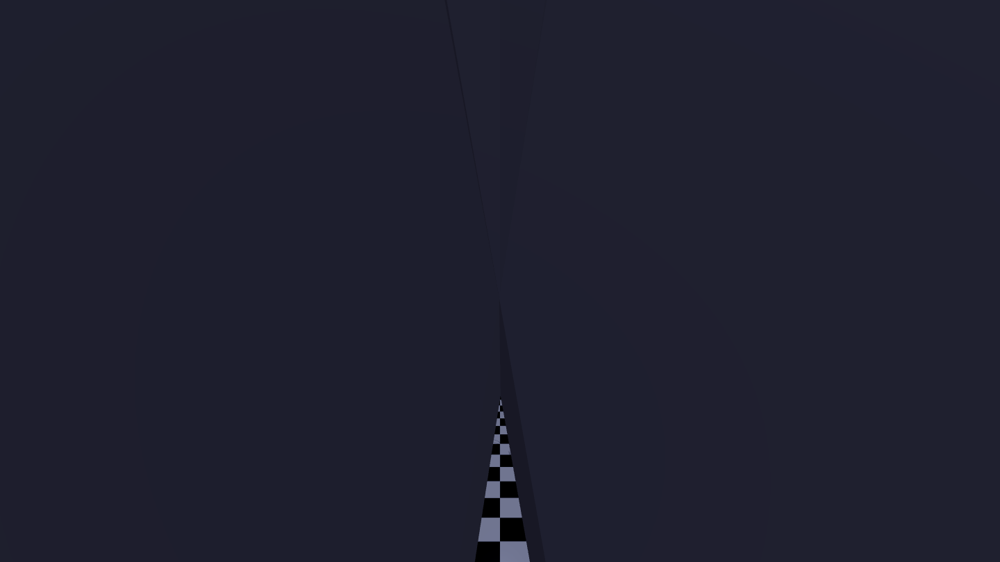
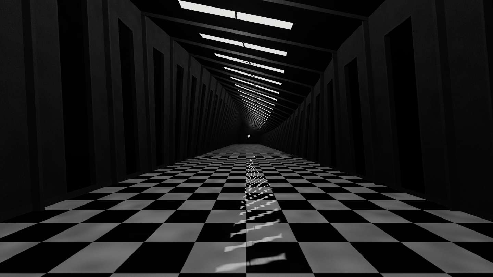
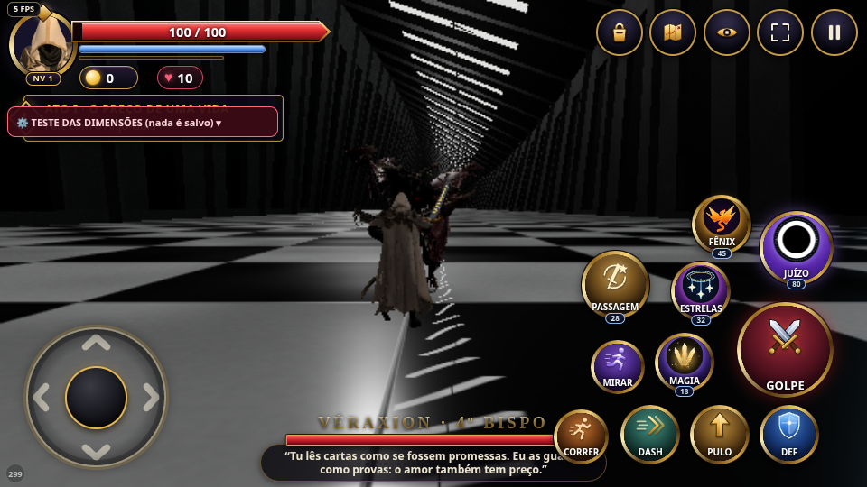

# Véraxion — corredor sem fim

Capturas **reais de WebGL**, executando o construtor de produção e o jogo completo. Referência original enviada no chat (16:9, marca verde “4”), examinada visualmente; não incorporada ao Git nem reproduzida por IA. O verde não faz parte do cenário.

| Antes (`1ca6437`) | Depois |
| --- | --- |
|  |  |

Mesma câmera `(0,12,38)`, alvo `(0,24,-2000)`, FOV 64°, exposição 1,1 e resolução 1440×810. A iluminação de cada versão é a do próprio tema. [Antes mobile](antes-mobile.png) · [Depois mobile](preview/06-corredor-mobile.png) (393×852).

[Porta rebaixada](preview/02-door.png) · [Teto/luminária](preview/02-ceiling.png) · [Piso](preview/02-floor.png) · [Reflexos ligados](preview/03-reflexo-ligado.png) / [desligados](preview/03-reflexo-desligado.png) · [Outra câmera](preview/04-reflexo-camera-lateral.png).

[Baixo](preview/05-low.png) · [Auto/Alto](preview/05-medium.png) · [Máximo](preview/05-high.png) · [Vídeo da sessão WebGL](preview/execucao.webm) · [Medições](preview/resultado.json).

## Jogo completo

[Vídeo do jogo real](runtime/execucao.webm) · [Caminhada](runtime/00-caminhada.png) · [Pulo](runtime/00-pulo.png) · [Dash](runtime/00-dash.png) · [Ataque](runtime/00-ataque.png) · [Giro da câmera](runtime/02-camera-girada.png) · [Quatro Sentenças](runtime/03-s1.png) · [Vórtices](runtime/03-s2.png) · [Ultimate: Bispo](runtime/04-ultimate-bispo.png) / [cosmos](runtime/04-ultimate-cosmos.png) / [retorno](runtime/04-ultimate-retorno.png) · [Combate restaurado](runtime/05-combate-restaurado.png) · [Reentrada mobile](runtime/06-reentrada-mobile.png) · [Resultados](runtime/resultado.json).

## Decisões e limites

- 32 seções retangulares conectadas, 64 portas com recesso, 32 luminárias com travessa e abertura distante. Piso plano contínuo, paredes/teto com cantos superiores progressivamente rotacionados. Sem círculo visível, toros, partículas ou luzes coloridas novas. O piso ancora a deformação arquitetônica, preservando circulação e leitura; não se gira câmera/jogador.
- A referência guiou enquadramento, escala monumental, monocromia, teto inclinado, portas negras e faixa reflexiva. Corrigidos nas iterações: torção helicoidal excessiva do piso, reflexos espúrios provocados por derivadas através de índices de luz descontínuos e vigas profundas que ocultavam luminárias distantes. **Diferenças restantes:** ritmo mais regular, inclinações do primeiro teto diferentes, materiais mais uniformes e ausência das microfissuras/fotorealismo da referência. Sem nota de similaridade ou aprovação artística automática.
- Reflexo **analítico das posições/orientações reais das luminárias**, com interseção raio/plano, limites retangulares, travessa, rugosidade, Fresnel e pequenas ondulações com redução por distância e filtragem pela projeção de um pixel. A câmera usada é a câmera efetiva de renderização, inclusive nas cinemáticas. Não reflete personagens ou paredes, nem resolve oclusão completa das vigas: é a alternativa mobile documentada, não um espelho de cena ou SSR.
- `Reflector` r160 foi avaliado: adicionaria render da cena e render target (padrão half-float com MSAA), caro com personagens/VFX. Escolhida reflexão sem passes/texturas/targets adicionais. PBR e iluminação difusa aproximada das luminárias no shader; sem 32 PointLights, sombras novas ou pós-processamento.
- Presets: Baixo = 1 candidato de reflexo + ferragens dos 10 módulos próximos; Auto/Alto = 3 + 20; Máximo = 5 + 32. Estrutura, portas, luminárias e piso permanecem. O restante do renderer conserva seus presets existentes.
- Cenário isolado: baseline **7 calls / 912 triângulos / 7 geometrias / 1 textura**; novo **6 calls**, **2.796 / 3.276 / 3.852 triângulos** por preset, **6 geometrias / 0 texturas**. Mais custo geométrico/shader que a base; não se afirma ganho de FPS. CPU no JSON mede submissão, não tempo GPU. Chromium/SwiftShader não representa Android físico.
- Raio caminhável **30 m** e posições de spawn intactos. Extensão além da arena é cenográfica. Sem alteração em colisões, IA, HP, saves, poderes, portal de acesso ou áudio. O kit atual de Véraxion tem `sword: null`; QA confirma isso e testa Quatro Sentenças e ataque do protagonista, sem restaurar habilidade removida.
- A ultimate já renderiza o cosmos em outra cena; a arquitetura permanece registrada/visível na arena e reaparece no retorno. Não foi criado um mecanismo novo para esconder o cenário ou alterar a câmera cinematográfica.
- Código novo em `veraxion-hall-dimension3d.js`; `dimension-arenas3d.js` somente delega tema/descarte. Dois ajustes no controlador compartilhado: descarte da arena do Bispo 4 ao sair e diagnóstico `hallVisualState()` restrito a `debug3d`. Outros temas e módulos de Eldória/Bispo 3 preservados. Nenhum novo asset externo, GLB, dependência de runtime ou alteração de release/cache.

## Pesquisa

[InstancedMesh](https://threejs.org/docs/pages/InstancedMesh.html), [MeshStandardMaterial](https://threejs.org/docs/pages/MeshStandardMaterial.html), [Reflector r160](https://github.com/mrdoob/three.js/blob/r160/examples/jsm/objects/Reflector.js), [WebGL best practices](https://developer.mozilla.org/en-US/docs/Web/API/WebGL_API/WebGL_best_practices). Código compilado e testado no Three **0.160.0**; APIs atuais não foram presumidas compatíveis sem verificação.

## Validação e reprodução

Base da branch atualizada semanticamente com `main` **11df7ee**, preservando as alterações já integradas por outros autores. **26/26** testes de dimensões e poderes do Bispo 4; **44/44** no contrato de build central. Suíte raiz: **461 aprovados / 3 falhas**, contra **457 / 3** na main em worktree isolada; mesmas falhas preexistentes em Mod 262, Mod 278 e região extra do terreno. Não foram removidas nem enfraquecidas. Sintaxe, onboarding (26 caminhos) e diff check aprovados.

QA WebGL: reflexão ligada/desligada, câmera alternativa sem update de gameplay, render/descarte dos outros quatro temas, três presets, três ciclos de dispose/recriação e descarte idempotente. QA do jogo: VS, caminhada, pulo, dash, ataque, colisões, giro, duas magias efetivamente observadas, ultimate sem pular o filme, retorno, saída com arena removida e reentrada. Zero erros JavaScript/WebGL ou assets HTTP falhos nas sessões finais; resultados reais nos JSONs. Teste Android físico e revisão artística pelo criador seguem pendentes.

Servir a raiz na porta 4174. Instalar `playwright@1.56.1` e `three@0.160.0` em diretório de QA; executar `tools/visual-lab/bispo4-hall-qa.cjs` e `bispo4-hall-runtime-qa.cjs` com `NODE_PATH` apontando para suas dependências. `CHROMIUM_PATH`, `VISUAL_OUTPUT` e `VISUAL_BASE_URL` opcionais. Preview: `tools/visual-lab/bispo4-hall-preview.html`; jogo: `mundo-3d-prototype.html?testeDimensao=bishop4&debug3d=1`. Workflow próprio somente leitura, sem deploy/merge; resultados remotos no PR.
