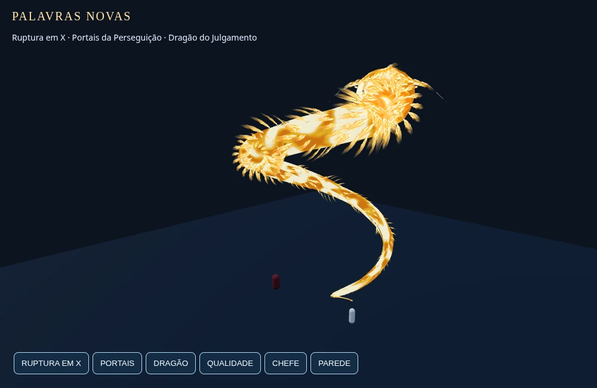
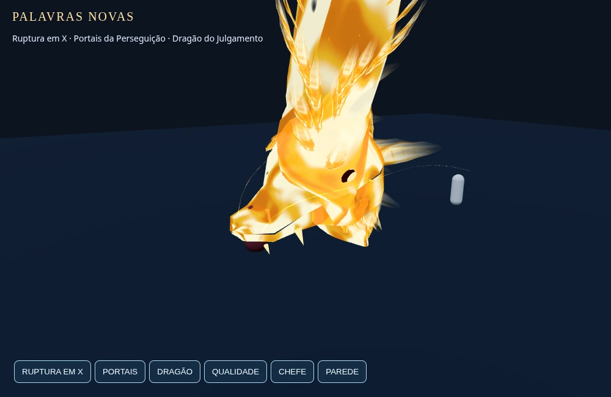
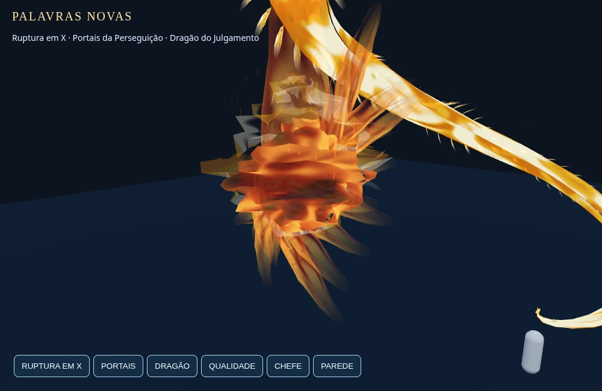
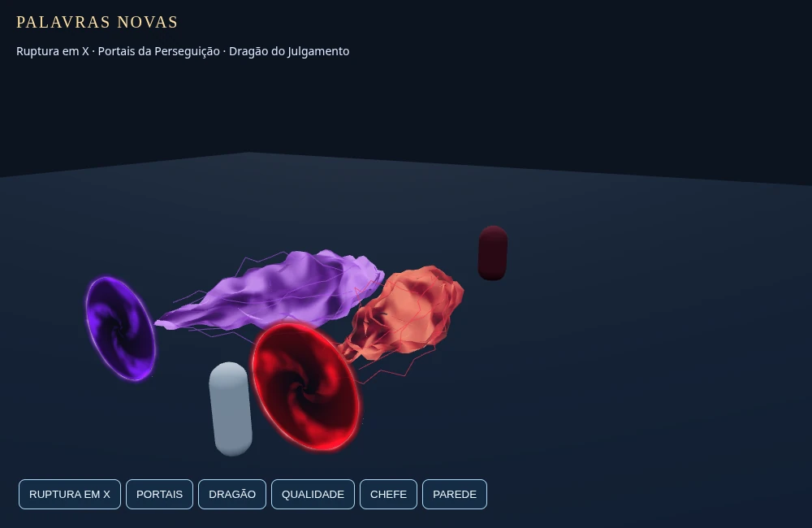
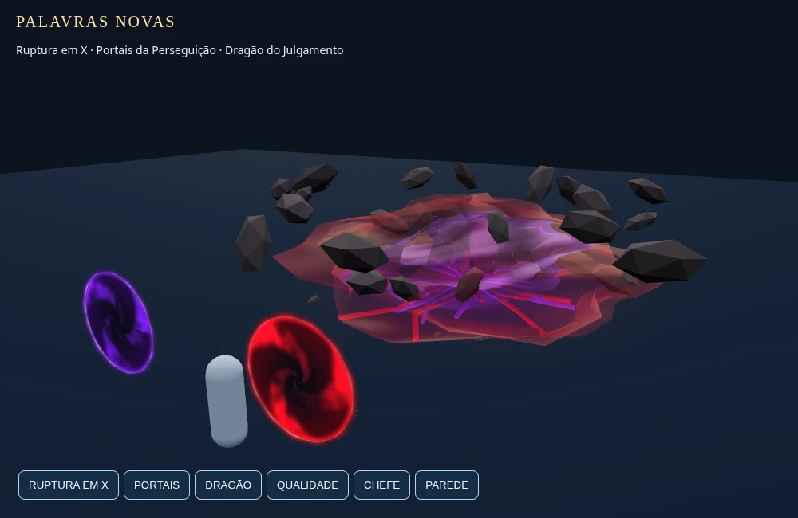
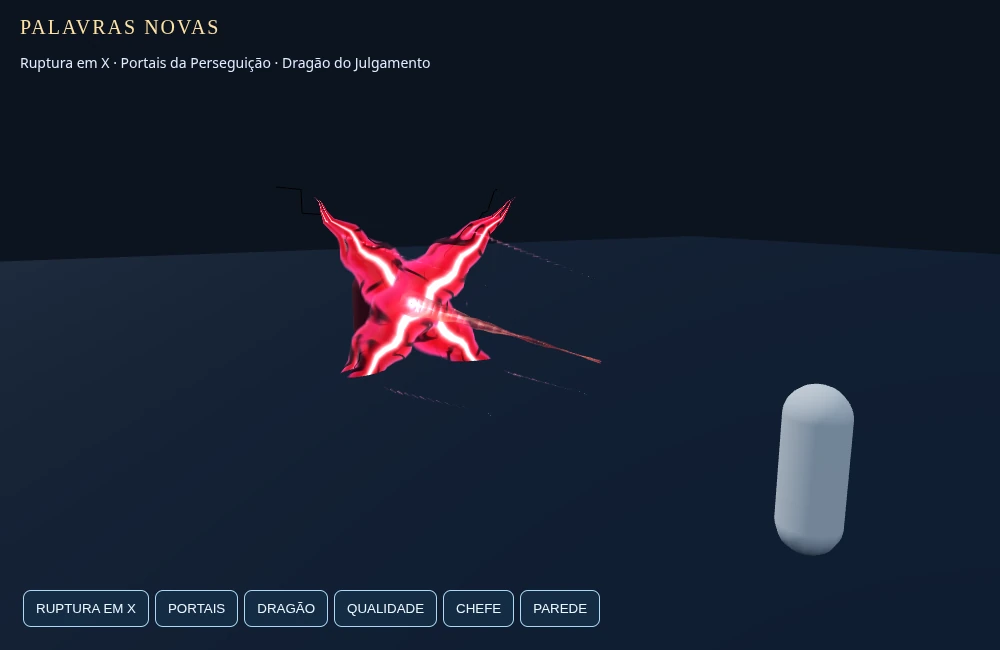
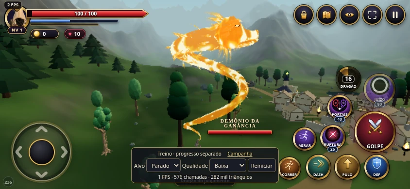
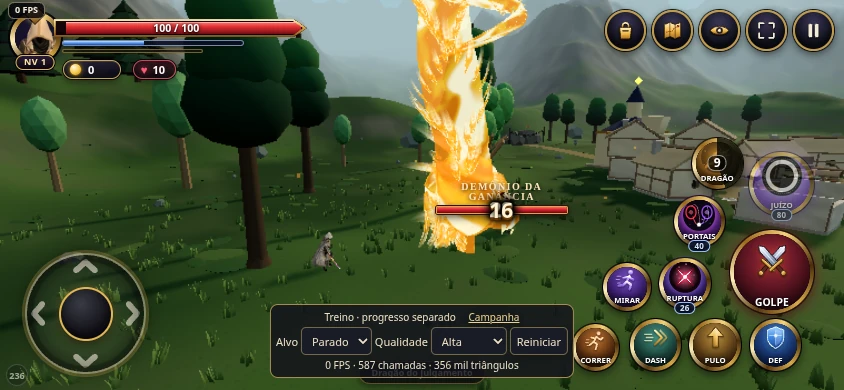
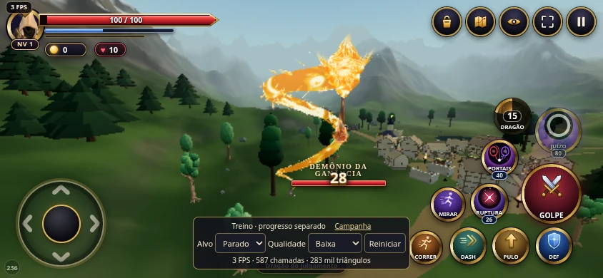
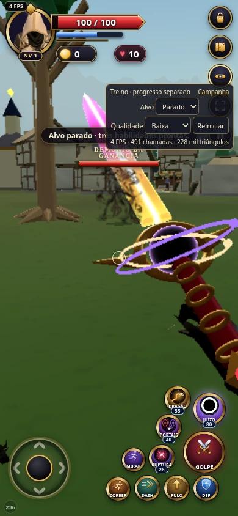

# Mod 236 — evidências de execução

Commit de implementação: `1a0770e` (a documentação e capturas foram adicionadas depois).
Ambiente: Chromium real com WebGL via SwiftShader, em Linux; viewports 844×390, 390×844 e 1000×650.
**Não foi usado um Android físico.** FPS de software não é previsão de FPS em Adreno/Mali.

## Referências e iterações

O ZIP anexado foi extraído fora do repositório. A imagem `dragao_referencia.jpg` foi inspecionada;
os dois vídeos reduzidos (11 s e 10,17 s) foram examinados em pranchas de frames, cobrindo sua duração.
As referências não são assets do jogo e não foram copiadas para o repositório.

A comparação guiou as correções: corpo contínuo e espiralado, sem vértebras de esferas; cabeça curta,
sem chifres rígidos dominantes; sobrancelhas, crina, mandíbula e contorno de fogo; material com fluxo
incandescente e dissolução. A primeira renderização tinha aparência metálica e chamas enterradas
na malha. Foram corrigidos a máscara de opacidade, a colocação/densidade das chamas, a paleta e o
alinhamento da cabeça com o alvo antes da mordida. A bola possui núcleo, corona, línguas instanciadas,
fumaça/brasas e trilha de posições físicas. Portais passaram de 24 disparos a duas massas únicas.

O teste por toque também encontrou brilho excessivo na Bíblia de invocação próxima da câmera.
As três habilidades agora usam uma apresentação discreta desse livro; o reinício do laboratório
limpa a invocação. Os demais poderes mantêm sua apresentação.

## Testes executados

- `node --test *.test.mjs`: **229 aprovados**, zero falhas. Registro: [unit-tests.txt](unit-tests.txt).
- [check_vfx236_browser.py](../../../tools/qa/check_vfx236_browser.py): as três skills no jogo real,
  1ª/3ª pessoa, dano base 38/58/66, alvos parado/móvel/solo/parede, perfis baixo/alto/máximo,
  combos de `prota` e `aurora`, escala do herói e montagem da espada. A parede de 4 m bloqueia X e
  portais; o dragão voa por cima dela. O teste de lógica adicional cobre parede alta interceptando
  o fogo e o mergulho. Nenhum dano remoto no modo solo. Registro: [game-browser.json](game-browser.json).
- [check_vfx236_entry.py](../../../tools/qa/check_vfx236_entry.py): entrada pública sem debug pelo
  iframe, toque em câmera/portais/reinício, viewport retrato, Mod visível e preservação de um save
  preexistente e de corações, inclusive com `resetGalaxy1=1`. Capturas finais do dragão baixo/alto,
  retorno à distância original (6 ou .72), arma na mão e ausência de erros de página/WebGL/HTTP.
  Registro: [touch-and-camera.json](touch-and-camera.json).
- [check_vfx236_preview.py](../../../tools/qa/check_vfx236_preview.py): todos os shaders das três
  skills em WebGL, fases e perfis, 20 repetições adicionais de cada skill depois do aquecimento
  (4 minutos de tempo simulado por skill), limpeza e descarte. Registros em
  [preview-resources.json](preview-resources.json).

### Recursos e medição

Os números abaixo são da cena reduzida; três draw calls / 1.202 triângulos pertencem ao piso e às
cápsulas de referência. Não são o custo total da campanha.

| Skill | Maior total amostrado de calls | Geometrias antes/depois de 20 reusos | Programas antes/depois |
| --- | ---: | ---: | ---: |
| X | 16 | 16 / 16 | 10 / 10 |
| Portais | 19 | 20 / 20 | 10 / 10 |
| Dragão | 21 | 26 / 26 | 11 / 11 |

Após `dispose()`, as três verificações voltaram a **3 geometrias e 1 programa** da cena básica.
No mesmo instante de carga do dragão, o perfil baixo desenhou 23.132 triângulos e o alto 46.470,
incluindo a cena de referência; o baixo conserva cabeça, corpo, bola e fases de dano.
O carregamento local da entrada pública demorou aproximadamente **11,3 s**. O HUD registrou
aproximadamente **1–4 FPS** no mundo com SwiftShader. Isto é uma limitação material do ambiente de
validação; não foi confirmado um orçamento de FPS em hardware Android. Não houve alteração no
renderer, sombras ou cenário para produzir uma medição artificialmente favorável.

## Capturas finais

As imagens são screenshots do renderer, convertidas para WebP sem redimensionamento.
