# Dimensão do Bispo 3 — capturas reais da Mod 296

Capturadas em Chromium/WebGL executando o código da branch. Não são concept art nem imagens geradas. O vídeo registra a sessão de QA em SwiftShader, com enquadramentos e tempos de animação controlados; não representa FPS de um celular.

## Antes / depois — mesmo ponto e FOV

| Base f0e5da5 | Mod 296 |
| --- | --- |
| 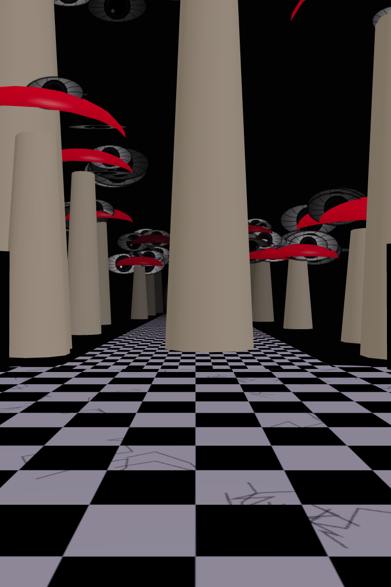 | 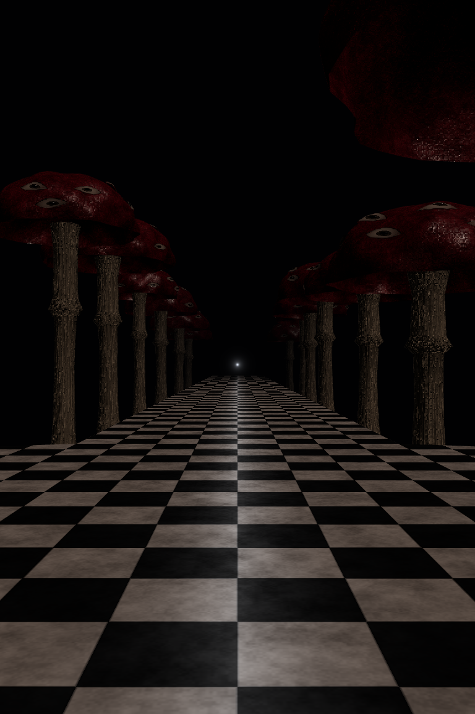 |

## Pálpebras e olhar

| Aberto | Fechando | Fechado | Reaberto |
| --- | --- | --- | --- |
| 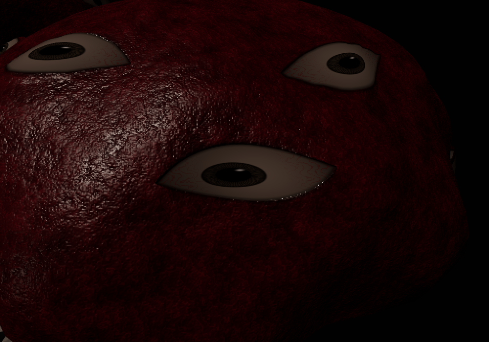 | 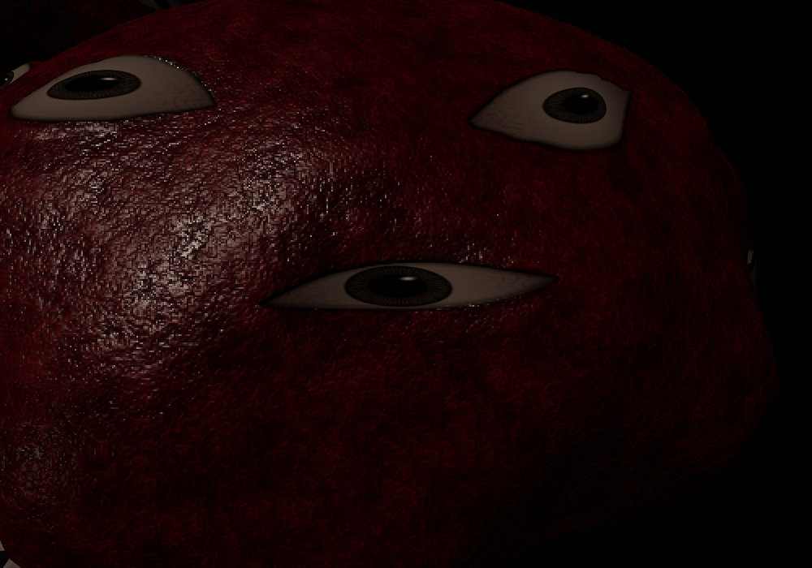 | 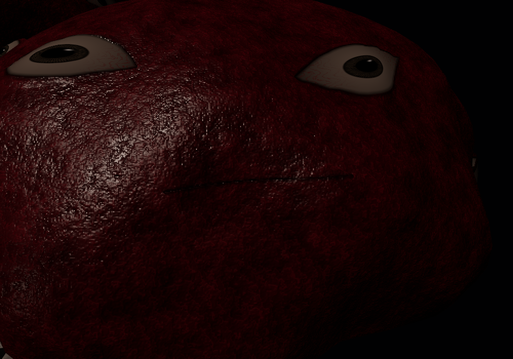 | 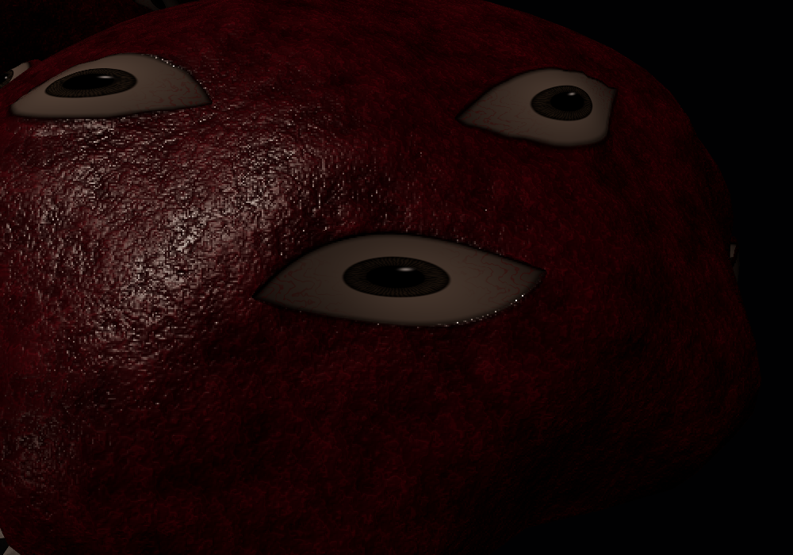 |

O olho central pisca; os demais conservam fases independentes.

| Alvo à esquerda | Alvo à direita |
| --- | --- |
| 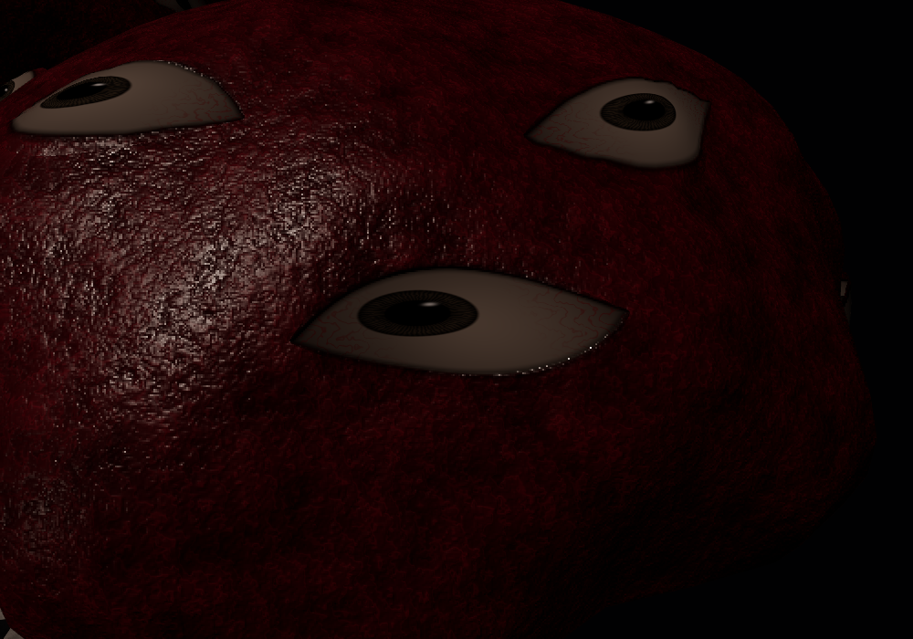 | 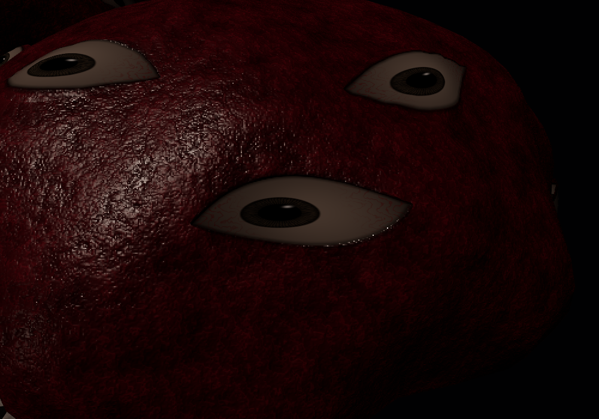 |

[Close no modo baixo](preview/09-close-low.png) · [Close no modo médio](preview/09-close-medium.png)

[Vídeo da sessão WebGL](preview/execucao-webgl.webm) · [Medições/qualidades/limpeza](preview/resultado.json)

## Jogo completo

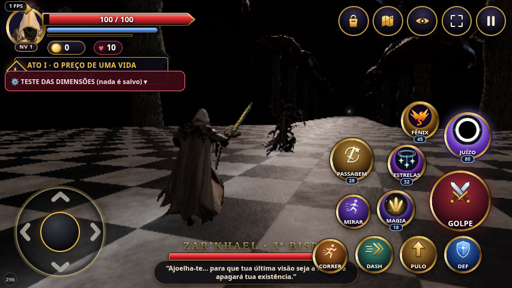

| Hidra em carga | Chamas disparadas |
| --- | --- |
| 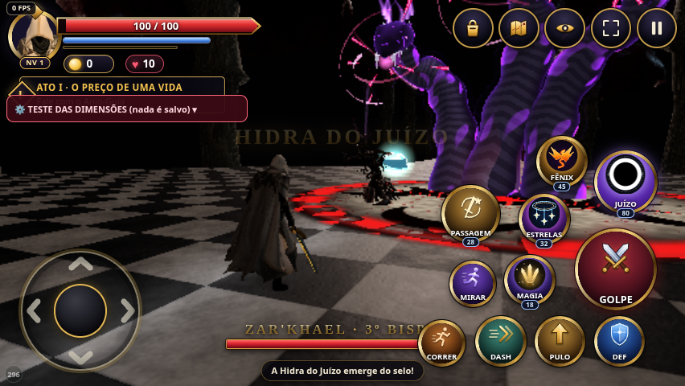 | 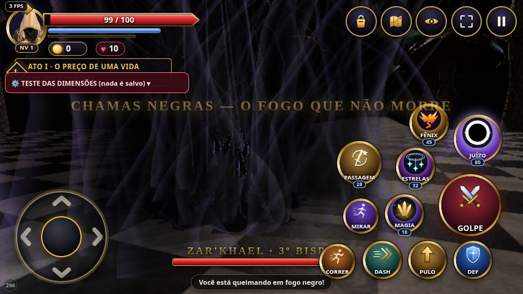 |

| Espada girando | Ultimate |
| --- | --- |
| 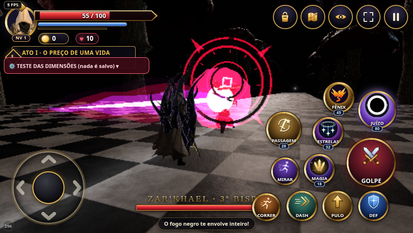 | 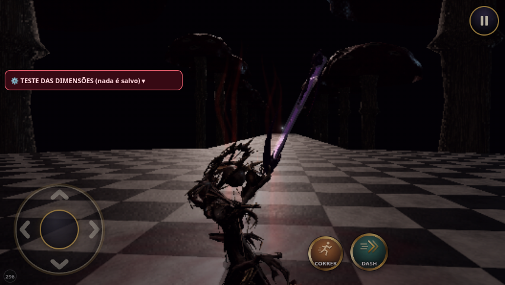 |

[Câmera da ultimate com arquitetura ocultada](runtime/03-camera-ultimate.png) · [Reentrada em retrato](runtime/04-reentrada-retrato.png) · [Resultados do runtime](runtime/resultado.json)

[Pesquisa, decisões, inventário, testes e diferenças frente à referência](../../auditorias/BISPO3-DIMENSAO-OLHOS-MOD296.md).

O preview e o teste de combate usam a mesma implementação do cenário. A prévia oferece câmera livre; a batalha mantém a câmera e a área caminhável existentes. Sem medição de Android físico. Sem merge ou alteração do Pages.
