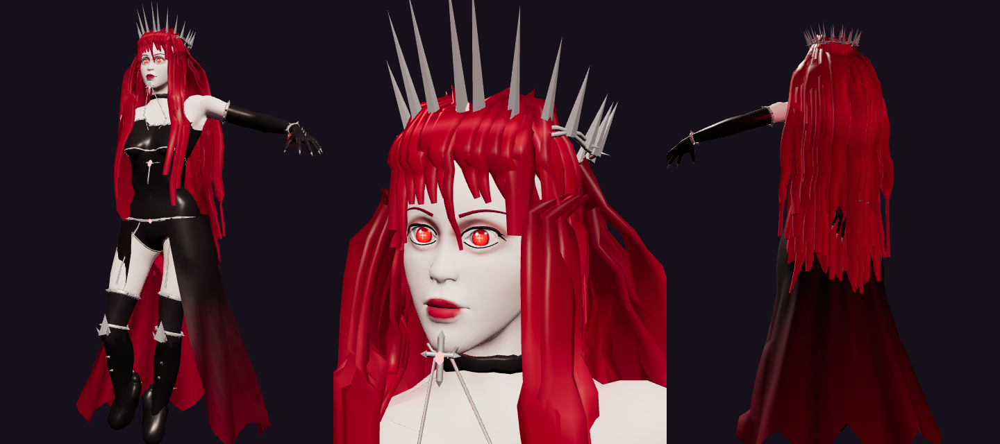

# Marco 8 — Polimento: a Sandra da referência, ultimates dos chefes e ajustes

**Fontes:**
- o documento mestre ([`GALAXIA-1-ROTEIRO-INTEGRAL-E-DIRECAO.pdf`](../GALAXIA-1-ROTEIRO-INTEGRAL-E-DIRECAO.pdf)): seções "Poderes", "Cutscenes, câmera e controles" e "Qualidade";
- a imagem de referência da Sandra enviada pelo autor.

Nenhuma fala, luta ou acontecimento foi removido. O único ajuste de cena: a revelação da Sandra ganhou um plano próprio.

## O que foi pedido → o que entrou

| ID | Pedido (resumo fiel) | No jogo |
|---|---|---|
| M8-01 | Sandra como na referência: cabelo vermelho longo, olhos vermelhos, coroa de espinhos, roupa gótica preta com prata, saia vermelha com fenda, meias e botas, garras, brincos em cruz e a "cruz demoníaca" | **Modelo novo (`Sandra-rig.glb`, script `tools/blender/m8_sandra.py`):** • **Corpo:** malha-base do MakeHuman (MPFB2, licença CC0) com alvos femininos, ajustada ao esqueleto da Misteriosa. Ela usa as mesmas animações, sem retarget. • **Rosto:** olhos maiores, com íris vermelha acesa e pupila em cruz (textura própria), cílios, sobrancelhas, sombra e boca vermelhas. • **Cabelo:** carmesim, até as coxas, com franja e mechas na frente dos ombros. • **Roupa:** coroa de espinhos de prata, gargantilha com cruz, correntes de espinhos no peito e corset preto com cruz e gema. Também cinto com espinhos, collant, cintas-liga, meias, luvas longas com braceletes e garras, e botas com joelheiras pontudas. • **Saia/capa:** preta por fora e carmesim por dentro, aberta na frente, com pontas rasgadas. • **Brincos:** em cruz. • **Cruz demoníaca:** aparece na ultimate dela, na queda da Ganância: surge no alto, gira, crava no chefe e solta cortes vermelhos. |
| M8-02 | A revelação "eu me chamo Sandra" | Plano próprio da câmera no rosto dela durante o clarão. Os dois modelos carregam antes do epílogo: ao continuar um jogo salvo nesse ponto, a Sandra antes não aparecia. Corrigido. |
| M8-03 | Pistas discretas da identidade da Sandra (documento mestre) | Mechas vermelhas dentro do capuz da pessoa misteriosa, coladas ao osso da cabeça. |
| M8-04 | VÉRAXION: fogo abissal e BLACK HOLE como ultimate obrigatória, sucção controlada, sem travar o jogador | **Fogo abissal:** linha de colunas de chamas negras e violeta até o herói, mais uma sob ele, com aviso no chão. **BURACO NEGRO** (abaixo de 60% e de 25% de vida): • **Forma:** núcleo negro com disco de acreção violeta e laranja. • **Sucção:** puxa o herói; dá para correr contra ela, e o dash escapa. • **Dano:** o núcleo fere quem chega perto; o colapso final explode. • **Câmera:** abre e volta sozinha, e o controle nunca é tirado. |
| M8-05 | Ganância (forma final): ultimate inspirada no impacto de "I Am Atomic", com linguagem e som próprios | **SUPERNOVA DA GANÂNCIA** (abaixo de 72% e de 30% de vida): • **Carga:** o mundo escurece; anéis de ouro e violeta marcam a área enquanto o ouro é sugado para o núcleo. • **Abrigo:** um círculo de luz no chão protege. • **Impacto:** implosão, silêncio curto, clarão branco e onda de choque. Quem está fora do abrigo e não usa o dash no instante do impacto leva dano alto. |
| M8-06 | Ultimates com câmera dramática que volta suave | **Câmera:** o Julgamento Divino do herói e as duas ultimates de chefe afastam e erguem a câmera, sem mudar o giro (o controle continua igual), e voltam suavemente. **Câmera lenta:** curta no início das ultimates. |
| M8-07 | Áudio próprio | Sons novos gerados no jogo: carga do buraco negro, fogo abissal, carga e explosão da Supernova. |
| M8-08 | Desempenho: não criar luzes durante o jogo | **Antes:** o Julgamento Divino criava uma luz nova a cada uso, recompilando shaders no meio da luta. **Agora:** usa uma luz única criada no início. |
| M8-09 | Deserto estável | **Posições fixas:** rochas, cactos e dunas ficam sempre no mesmo lugar (semente fixa). **Áreas livres:** o lugar do epílogo e o caminho da Sandra ficam sem pedras. Antes, uma pedra podia cair no meio da cena. |

## Decisões e limites (honesto)

- **Corpo da Sandra:** os dedos ficam rígidos (garras) e o rosto é estilizado, não esculpido à mão. A roupa é pintada no próprio corpo, com cortes retos nas bordas, mais peças de prata por cima.
- **Movimento:** cabelo e saia seguem o tronco e as pernas, sem física de pano. Em golpes muito abertos pode haver pequenas sobreposições.
- **Cruz demoníaca:** é efeito da ultimate. Ela não carrega a arma nas mãos, porque as animações da Misteriosa não seguram objetos.
- **Abrigo da Supernova:** foi o jeito escolhido de deixar a ultimate justa e legível (aviso claro + saída).
- **Rematch e Ato IV:** VÉRAXION usa o Buraco Negro nas duas lutas (perfil `veraxion`). A Ganância só usa a Supernova na forma final (`greed3`).
- **Evidência:**
  - **CONFIRMADO POR CÓDIGO:** `node --test`, 93 testes, entre eles os 2 de `ultimates3d.test.mjs` (limiares e ordem das ultimates).
  - **TESTADO EM NAVEGADOR** (Chromium com SwiftShader, roteiro automático): Sandra no epílogo (inclusive continuando do passo 29/1), Buraco Negro e Supernova (visual, dano, câmera, fim limpo), Atos III a VI e morte na dimensão, sem erros de página.
  - **Android: NÃO TESTADO.**
  - **SUSPEITA:** a sucção do Buraco Negro pode ficar forte demais com FPS muito baixo; ajuste fino depende de teste no celular.
